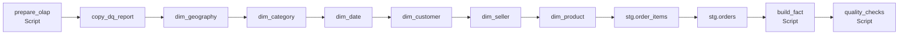

# Azure Data Factory

The ETL/ELT that turns the Olist OLTP database into the OLAP star schema the agent queries. The files use the ADF Git-integration layout, so this folder can be connected to a factory directly.

## Pipeline `pl_oltp_to_olap`

| Step | Type | What it does |
|---|---|---|
| `prepare_olap` | Script | Creates the `stg` schema, staging tables and the `dq_report` log, then truncates the targets for a full reload |
| `copy_dq_report` | Copy | Runs data-quality checks on the source (null and duplicate keys, orphan rows, negative prices, …) and appends them to `dq_report` |
| `copy_dim_*` | Copy | Extracts, cleans (trim, de-duplicate, translate categories) and loads the six dimensions |
| `copy_stg_*` | Copy | Lands order items and orders in staging |
| `build_fact` | Script | Builds `fact_order_item` in SQL (ELT), looking up surrogate keys and mapping unknown members to `-1` |
| `quality_checks` | Script | Compares fact row counts to the source checks and fails the run if they don't reconcile |

## Objects

| Folder | Object | Role |
|---|---|---|
| `linkedService/` | `ls_pg_oltp` | Source PostgreSQL (`olist_oltp`) |
| | `ls_pg_olap` | Target PostgreSQL (`olist_olap`) |
| | `ls_pg_tgs_data`, `ls_adls_gen2`, `ls_blob_source` | Bronze / raw-file connections |
| `dataset/` | `ds_oltp_query` | Query source on the OLTP database |
| | `ds_olap_table` | Parameterised target (`target_schema`, `target_table`) |
| | `ds_pg_bronze_table` | Parameterised bronze table (`TableName`) |
| `factory/` | `tgsadf` | Factory definition (system-assigned identity, North Europe) |

## Deploy

1. In ADF Studio, open **Manage → Git configuration** and point it at this repo with root folder `/adf`.
2. Fill in the placeholders (`<postgres-server>`, `<username>`, `<storage-account>`) in `linkedService/`, and set credentials through Key Vault or managed identity. Never commit them.
3. Publish and trigger `pl_oltp_to_olap`.
